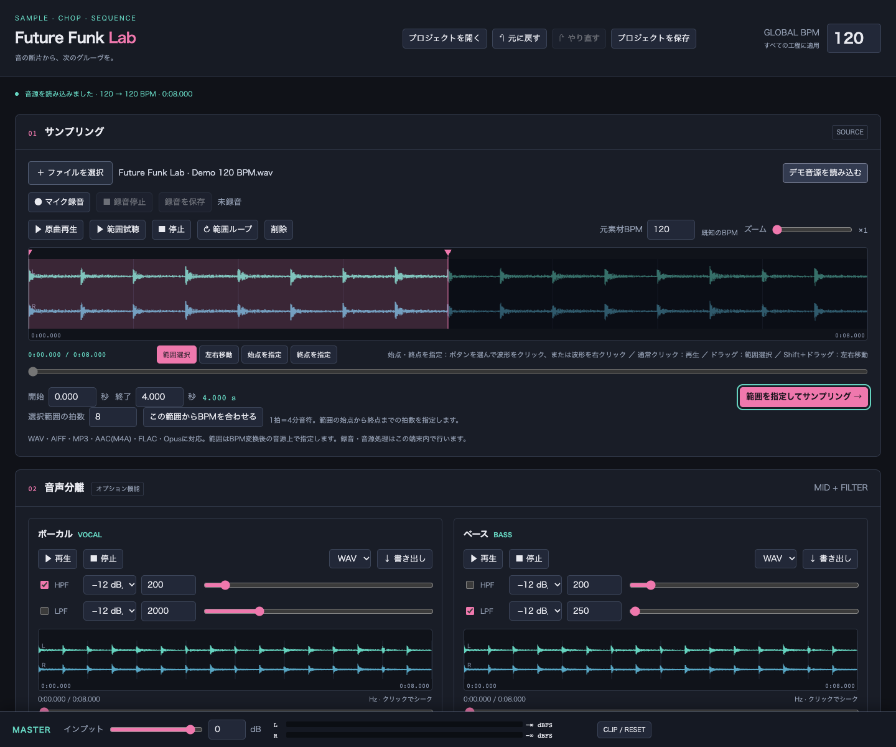
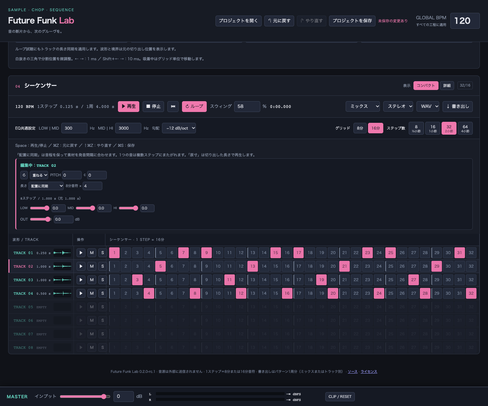

# Future Funk Lab

音源を取り込み、範囲をチョップして、8トラックのステップシーケンサーで組み立てるブラウザサンプラーです。音源は端末内で処理します。

ローカルで使用するアプリです。GitHub Pagesによるアプリの一般公開は停止し、自動公開ワークフローも無効化しています（2026-10-18）。確認済み環境はmacOS Chromeです。

## 画面

内蔵デモ音源を使った実際の画面です。

**サンプリング** — 原曲波形から範囲を選択し、再生・ズーム・始点／終点の調整を行います。



**シーケンサー** — 4つにチョップした素材を16ステップに配置した例です。トラックごとに長さ同期・ピッチ・EQ・音量を調整できます。



## 起動

生成済みの **[dist/index.html](dist/index.html)** をChromeで開くと使えます。`dist/` はGit管理対象外なので、リポジトリを取得した直後は以下の手順でビルドしてください。外部CDN、音源のサーバーへのアップロード、実行時のネット接続は不要です。依存の初回インストール（`npm ci`）にはネット接続が必要です。

開発・再ビルドする場合はNode.js 22以上を用意してください。

```sh
npm ci
npm run build
npm run dev
```

`http://127.0.0.1:5173` を開いてください。マイク録音はブラウザの権限許可が必要です。動作確認環境はmacOSのChromeです。マイク入力に問題がある場合はHTMLの直接起動ではなくlocalhostを使ってください。

`index.html` はビルド用のテンプレートです。実行するファイルは `dist/index.html` です。`src/` の変更後は `npm run build` で更新します。

## 操作

1. WAV／MP3を選択するか、マイク録音を停止して音源を取り込みます。「デモ音源を読み込む」でも試せます。
2. 読み込み時は原曲BPMをグローバルBPMに設定し、元の速さで始めます。解析結果を修正しても、グローバルBPMを手動変更するまでは原速を維持します。推定BPMで合わない場合は、拍頭から拍頭まで範囲を選び、その中の拍数を指定して「この範囲からBPMを合わせる」を押します。テンポを変えたいときだけ、右上のグローバルBPMを変更します。
3. 原曲波形をクリックして任意の位置から聴き、波形をドラッグして範囲を選べます。拡大後の左右移動は「左右移動」ボタン、Shift＋ドラッグ、横スクロールで行います。境界線・三角マーカー・秒数入力で範囲を微調整し、「範囲を指定してサンプリング」を押します。
4. 2〜8区間に分割します。ループ試聴は同時に1つだけで、別の区間を押すと切り替わります。波形の再生線・時刻・進行バーを見ながら境界を調整でき、調整中も試聴を続けます。「拍に吸着」は選択範囲の始点を拍頭として、選んでいるグリッド（8分／16分）に分割位置を揃えます。内部マーカーのドラッグまたは矢印キーで微調整できます。
5. トラックのステップをクリックし、再生します。初期値の「配置に同期」は素材を複数ステップにまたがる長さへタイムストレッチし、チョップのループ試聴にも同じ長さを適用します。シーケンサー開始時は試聴を止め、パターンだけを再生します。ピッチ、EQ、ボリューム、ミュート／ソロを調整できます。
6. 「ミックス」または「トラック別」、ステレオ／モノ、WAV／MP3を選んで書き出します。「トラック別」はミックスで鳴っているトラックを1本ずつ書き出し、ZIP 1ファイル（`track01.wav` など）にまとめます。全部を足すとミックスと同じ音になるので、DAWに並べて続きを作れます。
7. 右上の「プロジェクトを保存」（⌘S／Ctrl+S）で、音源と設定を `.fflab` ファイルに保存します。「プロジェクトを開く」で続きから作業できます。

グリッドは**8分**（初期値）と**16分**から選べます。8分では4／8／16／32ステップ（4/8〜32/8拍子）、16分では8／16／32／64ステップで、どちらも½・1・2・4小節（4/4）に対応します。8分⇔16分を切り替えても、置いた音の時間上の位置は変わりません。16分から8分に戻すとき、16分の裏にある音は確認のうえ消えます。BPMは4分音符基準です。「スウィング」（50〜75%）は、選んでいるグリッドの裏のステップを遅らせます。50%でずれなし、再生と書き出しは同じ位置で鳴ります。「拍に吸着」は選んでいるグリッドに揃えます。サンプルの長さは任意で、1ステップに切り詰めません。トラックごとの「配置に同期」は発音間隔へ音程を保って伸縮し、「ステップ数を指定」は任意の複数ステップ分へ合わせます。「原寸」は切り出した長さを保ちます。「重ねる」は次の発音と重なり、「切る」は同じトラックの前の音を約5 msで止めます。

拡大中にマーカーが画面外にあっても、**「始点を指定」または「終点を指定」を選び、波形上の任意の位置をクリック**して片側だけを変更できます。波形を右クリックし「この位置を始点にする／終点にする」でも指定できます。指定後は通常操作に戻り、ズーム・表示位置は維持します。

原曲波形は通常のドラッグで範囲選択、クリックでその位置から再生します。左右どちらの向きのドラッグでも選択でき、拡大中も同じ操作です。左右移動は「左右移動」ボタンまたはShift＋ドラッグを使い、横スクロールとスクロールバーも使えます。クリックでは選択範囲を変更しません。「原曲再生」は再生位置から曲末まで、「範囲試聴」は選択した区間だけを再生します。「範囲ループ」は範囲試聴に適用します。停止後も再生位置を保持し、原曲再生で再開できます。波形にフォーカス中は左右キーで1秒（Shift併用で0.1秒）シーク、Spaceで原曲再生／停止、Home／Endで先頭／末尾へ移動します。

マスターの音量・L/Rピークメーター・クリップ表示は、画面下部に常時表示します。

音声分離はMid成分＋フィルターによる簡易処理です。ボーカル／ベースの完全分離ではありません。分離した音はパートごとに書き出し、チョップには引き継ぎません。

## 実装上の補足

- ループとシーケンサーの拍ずれの調査・修正は [時間軸の検証](docs/timing-audit.md) に記載しています。
- 初版の未決事項と実装判断は [実装仕様](docs/implementation.md) に記載しています。
- WAVは44.1 kHz／16 bit PCM、MP3は44.1 kHz／192 kbpsです。
- ピッチは長さを維持します。操作後にワーカーで再処理し、再生位置を維持して差し替えます。反映までの時間は素材長・端末性能に依存します。
- 素材とBPM変換後の音源は最大10分です。処理用メモリが必要なため、長い音源では時間がかかります。
- プロジェクトファイル（`.fflab`）には、BPM変換前の元音源を32-bit floatのWAVで入れます。開き直したときのトラックの音を保存前とビット単位で一致させるためです。4分のステレオ音源で約85 MBになります。
- 作業中の内容は2秒ごとにブラウザ内（IndexedDB）へ自動保存します。次に開いたとき「前回の作業を復元できます」と表示し、「復元する」で戻せます。自動保存は1件だけで、新しい音源を読み込むと上書きします。ブラウザの保存データを消すと自動保存も消えるため、残したい作業はファイルに保存してください。
- 再生位置・ズーム・録音の未保存状態は、プロジェクトに含めません。

## 検証

```sh
npm test
npm run build
npm run test:browser
```

ブラウザテストはChromeを起動します。macOSの標準インストール先以外では `CHROME_PATH` でChrome実行ファイルを指定してください。マイクテストは仮想入力を使用します。

DSPの長さ・周波数、8分音符グリッド、WAV／MP3生成、取り込みから書き出しまでの操作、BPM変更後の位置保持、波形操作、フィルター、EQ、ミュート／ソロ、録音、単一HTMLの直接起動、プロジェクトの保存・読み込み・自動保存を確認します。

## 構成

- `src/app.js` — 画面・状態・音声処理ジョブ
- `src/audio.js` — 音声クロックによる周期再生、EQ、フィルター、オフラインレンダリング
- `src/core.js` — 時刻・境界・BPM解析・WAVエンコード
- `src/dsp.js`, `src/worker.js` — タイムストレッチ、ピッチ変更、MP3エンコード
- `src/waveform.js` — 波形描画、ズーム、範囲・境界操作
- `src/project.js`, `src/autosave.js` — プロジェクトファイルの形式・検証と、ブラウザ内の自動保存
- `scripts/build.mjs` — 依存を含む単一HTML生成
- `tests/` — DSP・ブラウザテスト

音声処理には [SoundTouchJS](https://github.com/cutterbl/SoundTouchJS) と [lamejs](https://github.com/shijinyu/lamejs) を使っています。第三者ライセンスは [THIRD_PARTY_NOTICES.md](THIRD_PARTY_NOTICES.md) とビルド先の `dist/licenses/` に含めています。

## 配布候補の作成

```sh
npm run release
```

ビルド、単体テスト、ブラウザテストの順に実行し、すべて成功した場合だけ `release/Future-Funk-Lab-<version>.tar.gz` とSHA-256を生成します。macOS版Chromeで確認したリリース候補です。配布物には起動用HTML、再ビルド用ソース、固定した依存情報、第三者コードとライセンス、ファイルごとのハッシュを同梱します。検証用の楽曲・録音・出力音声は含めません。

`dist/` はローカル検証の作業先でもあるため、フォルダ全体を配布せず、このパッケージを使ってください。

## リモート保存と公開状態

アプリの利用にWebでの一般公開やホスティング契約は必要ありません。GitHubへのコードの反映と、アプリの一般公開は別の操作です。一般公開を再開する場合は、事前に所有者の明示的な承認を得てください。

2026-10-18にGitHub Pagesのサイト設定を削除し、旧公開URLが404になることを確認しました。GitHub Actionsの `publish.yml` も無効化しており、`main` へのpushによる自動公開は停止しています。

GitHubリポジトリと既存のリリースは公開状態です。Pagesの停止は、コードや既に配布したファイルの非公開化・回収を意味しません。

`npm run site` は配信用ファイルをローカルで生成するコマンドです。このコマンド自体ではアップロードしません。検証用の実音源を含む `dist/` 全体をアップロードしないでください。

GitHubリポジトリ: https://github.com/masa-san-jp/Future-Funk-Lab
